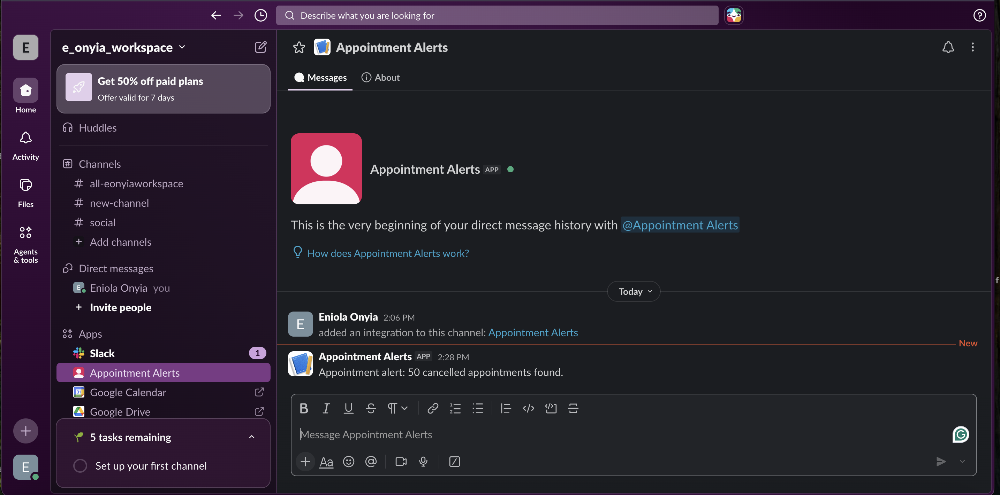

# FHIR Appointment Alerts

A Python script that checks a FHIR test server for cancelled appointments and posts a summary to Slack.

## Who it's for
Clinic operations teams who want a quick daily signal about cancellations without logging into their scheduling system.

## What it does
1. Pulls Appointment records with status "cancelled" from the public HAPI FHIR test server that uses synthetic data only.
2. Counts them.
3. Sends a summary message to a Slack channel through an Incoming Webhook.

## Sample output

## Setup
1. Install Python 3 and run `pip3 install requests`.
2. Create a Slack app with an Incoming Webhook and copy the URL.
3. In your terminal, set the webhook as an environment variable (never save it in the code):
   `export SLACK_WEBHOOK_URL="your-webhook-url"`
4. Run `python3 alerts.py`.

## How it works
The script sends a GET request to the FHIR `Appointment` endpoint with a status filter, reads the JSON response, counts the entries, and posts the count to Slack. The webhook URL is read from an environment variable so credentials never end up in the repository.

## What I learned
I learned how the pipeline pulls iinformation from the FHIR appointment data repository and how to query it with a status filter. I also learned howed to debug the text. When the Slack step failed with an error message or populated as problems", I read the end of the traceback, found leftover placeholder text in the webhook URL, and fixed it. Troubleshooting from the error message is a reality that may come up with customers so it is helpful to know when trying to troubleshoot why a solution may not be working as intended on their end.

## Next steps
Filter by date range, add no-show status, and schedule it to run daily.
